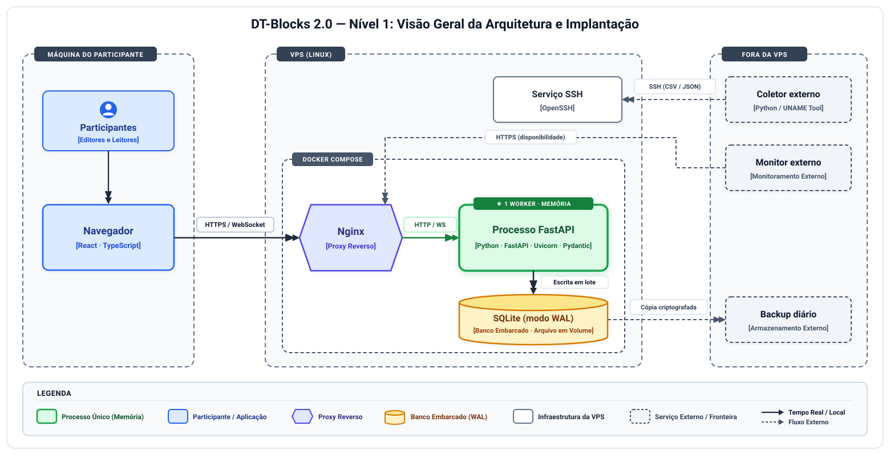
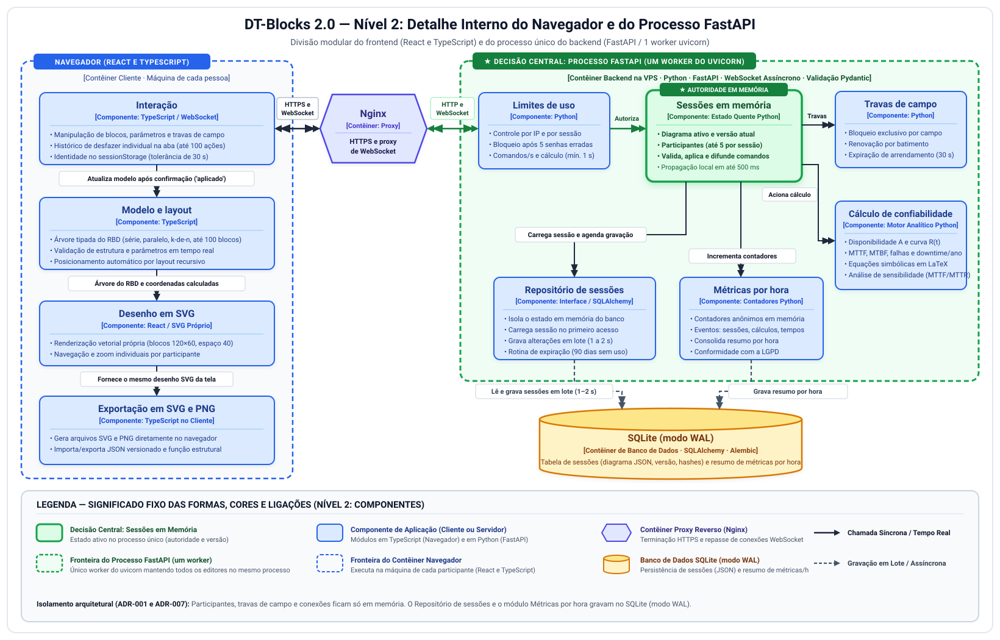
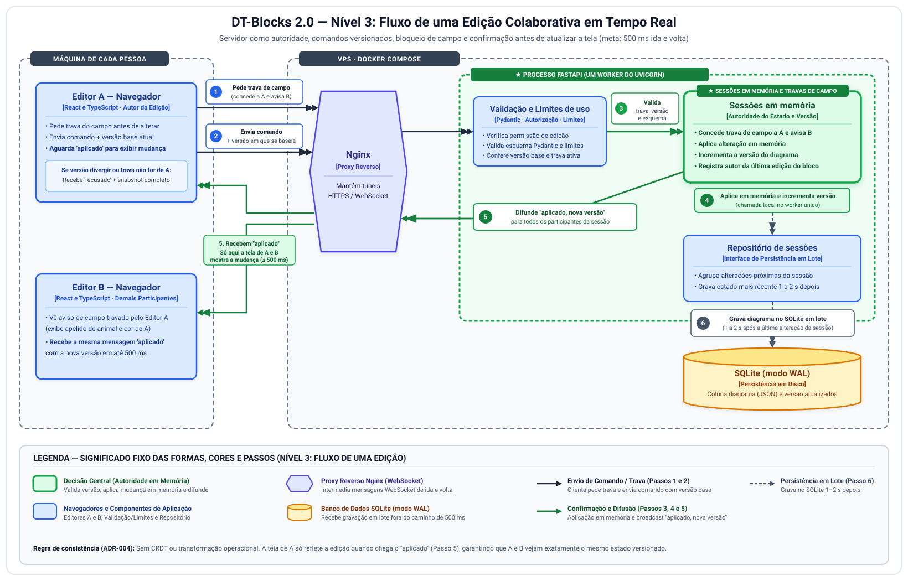

# Desenho de Arquitetura — DT-Blocks 2.0

Este documento reúne o desenho de arquitetura do **DT-Blocks 2.0**, elaborado a partir do [Documento de requisitos - RBD.md](file:///c:/Users/sever/Documents/dt-blocks/Documento%20de%20requisitos%20-%20RBD.md) e do [DT-Blocks 2.0 System Design.md](file:///c:/Users/sever/Documents/dt-blocks/DT-Blocks%202.0%20System%20Design.md), modelado e validado com o **Structurizr DSL** ([workspace.dsl](file:///c:/Users/sever/Documents/dt-blocks/arquitetura/workspace.dsl)).

---

## 1. Estrutura dos Diagramas (Um Nível de Detalhe por Diagrama)

Para evitar sobrecarga visual e respeitar as boas práticas de arquitetura (modelo C4), o desenho foi dividido em três visões complementares:

1. **Nível 1 — Visão Geral da Arquitetura e Implantação** ([nivel1-visao-geral.svg](file:///c:/Users/sever/Documents/dt-blocks/arquitetura/nivel1-visao-geral.svg) | [nivel1-visao-geral.png](file:///c:/Users/sever/Documents/dt-blocks/arquitetura/nivel1-visao-geral.png) | [Mermaid](file:///c:/Users/sever/Documents/dt-blocks/arquitetura/mermaid/Nivel1_VisaoGeral.mmd) | [C4-PlantUML](file:///c:/Users/sever/Documents/dt-blocks/arquitetura/c4-plantuml/Nivel1_VisaoGeral.puml))
   - Diagrama principal de alto nível, enxuto e direto: apresenta as três fronteiras de implantação (**Máquina do Participante**, **VPS** com **Docker Compose** e **Fora da VPS**), os elementos principais com suas tecnologias (**Participantes**, **Navegador**, **Nginx**, **Processo FastAPI** com 1 worker e estado em memória, **SQLite (modo WAL)** embarcado em arquivo/volume e **Serviço SSH**) e os serviços externos (**Coletor externo**, **Monitor externo** e **Backup diário**).
2. **Nível 2 — Detalhe Interno do Navegador e do Processo FastAPI** ([nivel2-detalhe-componentes.svg](file:///c:/Users/sever/Documents/dt-blocks/arquitetura/nivel2-detalhe-componentes.svg) | [Mermaid FastAPI](file:///c:/Users/sever/Documents/dt-blocks/arquitetura/mermaid/Nivel2A_DetalheProcessoFastAPI.mmd) | [Mermaid Navegador](file:///c:/Users/sever/Documents/dt-blocks/arquitetura/mermaid/Nivel2B_DetalheNavegador.mmd) | [C4-PlantUML FastAPI](file:///c:/Users/sever/Documents/dt-blocks/arquitetura/c4-plantuml/Nivel2A_DetalheProcessoFastAPI.puml) | [C4-PlantUML Navegador](file:///c:/Users/sever/Documents/dt-blocks/arquitetura/c4-plantuml/Nivel2B_DetalheNavegador.puml))
   - Detalha os **4 componentes do Navegador** (*Interação*, *Modelo e layout*, *Desenho em SVG* e *Exportação em SVG e PNG*) e os **6 componentes do Processo FastAPI** (*Limites de uso*, *Sessões em memória*, *Travas de campo*, *Cálculo de confiabilidade*, *Repositório de sessões* e *Métricas por hora*), mantendo o módulo *Métricas por hora* gravando diretamente no *SQLite (modo WAL)* e o *Repositório de sessões* persistindo as sessões em lote.
3. **Nível 3 — Fluxo de uma Edição em Tempo Real** ([nivel3-fluxo-edicao.svg](file:///c:/Users/sever/Documents/dt-blocks/arquitetura/nivel3-fluxo-edicao.svg) | [Mermaid](file:///c:/Users/sever/Documents/dt-blocks/arquitetura/mermaid/Nivel3_FluxoEdicao.mmd) | [C4-PlantUML](file:///c:/Users/sever/Documents/dt-blocks/arquitetura/c4-plantuml/Nivel3_FluxoEdicao.puml))
   - Representa os **6 passos numerados** de uma edição colaborativa (pedido de trava $\rightarrow$ envio de comando com versão base $\rightarrow$ validação $\rightarrow$ aplicação em memória e incremento de versão $\rightarrow$ difusão do `"aplicado, nova versão"` aos participantes $\rightarrow$ gravação em lote no SQLite 1 a 2 s depois).

---

## 2. Legenda Unificada (Formas, Cores e Ligações)

| Forma Visual | Cor (Preenchimento / Borda) | Significado Arquitetural | Elementos no Desenho |
| :--- | :--- | :--- | :--- |
| **Retângulo arredondado com borda espessa e selo `★`** | **Verde-esmeralda** (`#DCFCE7` / `#16A34A`) | **Decisão Central da Arquitetura:** Processo único com estado das sessões em memória (autoridade e propagação em até 500 ms) | `Processo FastAPI (um worker)`, `Sessões em memória` |
| **Retângulo arredondado (borda sólida)** | **Azul** (`#DBEAFE` / `#2563EB`) | **Participantes, Contêiner Cliente e Componentes de Aplicação** | `Participantes da sessão`, `Navegador`, `Modelo e layout`, `Desenho em SVG`, `Interação`, `Exportação em SVG e PNG`, `Limites de uso`, `Travas de campo`, `Cálculo de confiabilidade`, `Repositório de sessões`, `Métricas por hora` |
| **Hexágono (Gateway)** | **Índigo** (`#E0E7FF` / `#4F46E5`) | **Proxy Reverso e Terminação de Rede** | `Nginx` (HTTPS e proxy de WebSocket) |
| **Cilindro** | **Âmbar / Laranja** (`#FEF3C7` / `#D97706`) | **Armazenamento Persistente (Banco em Arquivo)** | `SQLite (modo WAL)` |
| **Retângulo arredondado branco** | **Branco / Cinza** (`#FFFFFF` / `#64748B`) | **Nó de Infraestrutura da VPS** (serviço do sistema operacional/ambiente, não é componente de aplicação) | `Serviço SSH` (`OpenSSH`), `certbot` |
| **Retângulo arredondado com borda tracejada** | **Cinza-claro** (`#F1F5F9` / `#475569`) | **Nó Externo (Fora da VPS)** | `Monitor externo`, `Coletor externo`, `Backup diário` |
| **Caixa ampla tracejada com rótulo superior** | **Cinza-azulado** (`#F8FAFC` / `#64748B`) | **Fronteira de Ambiente / Implantação** | `Máquina de cada pessoa`, `VPS`, `Docker Compose`, `Fora da VPS` |
| **Seta contínua (`───▶`)** | **Cinza-escuro (`#1E293B`) ou Verde (`#15803D`)** | **Comunicação Síncrona ou em Tempo Real** | HTTPS, WebSocket, chamadas em memória no processo |
| **Seta tracejada (`- - ▶`)** | **Cinza-médio (`#475569`)** | **Fluxo Operacional, Assíncrono ou em Lote** | Gravação em lote no SQLite (1–2 s), coleta por SSH, consulta de monitoramento e cópia diária criptografada |

---

## 3. Visualização dos Diagramas

### 3.1. Nível 1 — Visão Geral da Arquitetura e Implantação

### 3.2. Nível 2 — Detalhe Interno do Navegador e do Processo FastAPI

### 3.3. Nível 3 — Fluxo de uma Edição Colaborativa em Tempo Real

---

## 4. Rastreabilidade Completa contra as Fontes

| Elemento / Ligação no Desenho | Requisitos Relacionados | Decisões do System Design |
| :--- | :--- | :--- |
| **Participantes (até 5 simultâneos, acesso por link de edição/leitura, senha opcional, apelido e cor)** | RN-012, RN-013, RN-015, RN-017, RF-009 a RF-013, RF-016, RNF-003 a RNF-005, RNF-013, RNF-015, RNF-018 | ADR-006, ADR-010 |
| **Navegador (React e TypeScript)** | RNF-020, RNF-021, RNF-022 | Visão Geral, ADR-003 |
| **Navegador → Modelo e layout** | RN-010, RN-011, RF-001 a RF-004, RF-008 | ADR-003, ADR-012 |
| **Navegador → Desenho em SVG** | RF-007, RF-008 | ADR-003, ADR-012 |
| **Navegador → Interação** | RN-016, RN-019, RF-005, RF-006, RF-012, RF-014 | ADR-003, ADR-004, ADR-005, ADR-006 |
| **Navegador → Exportação em SVG e PNG (e JSON / função estrutural)** | RF-027 a RF-033, RNF-008 | ADR-003, ADR-013 |
| **Nginx (HTTPS e proxy de WebSocket) + certbot + Docker Compose na VPS** | RNF-006, RNF-010 | Visão Geral, ADR-009, ADR-014 |
| **Processo FastAPI (um worker) + Sessões em memória (Decisão Central)** | RF-012, RNF-016 (meta 500 ms, máx. 1 s), RNF-018 | Visão Geral, ADR-001, ADR-002, ADR-004, ADR-008 |
| **Processo FastAPI → Travas de campo** | RN-016, RF-014, RNF-011 (liberação em até 30 s) | Visão Geral, ADR-005 |
| **Processo FastAPI → Cálculo de confiabilidade** | RN-001 a RN-009, RN-018, RF-017 a RF-026, RNF-001, RNF-002, RNF-017 (máx. 5 s) | Visão Geral, ADR-002 |
| **Processo FastAPI → Limites de uso** | RN-015, RF-016, RF-018, RNF-005, RNF-019 | Visão Geral, ADR-011 |
| **Processo FastAPI → Métricas por hora** | RNF-009 (LGPD, métricas anônimas) | Visão Geral, ADR-017 |
| **Processo FastAPI → Repositório de sessões** | RN-014, RF-015, RNF-012 | Visão Geral, ADR-001, ADR-007 |
| **SQLite (modo WAL)** | RN-014, RF-015, RNF-012 | Visão Geral, Tabela de sessões, ADR-007 |
| **Monitor externo → Nginx** | RNF-010 (disponibilidade mensal ≥ 95%) | Visão Geral, ADR-016 |
| **Coletor externo → Serviço SSH (VPS)** | RNF-009 | Visão Geral, ADR-017 |
| **SQLite (modo WAL) → Backup diário** | RNF-010, RNF-012 | Visão Geral, ADR-015 |
